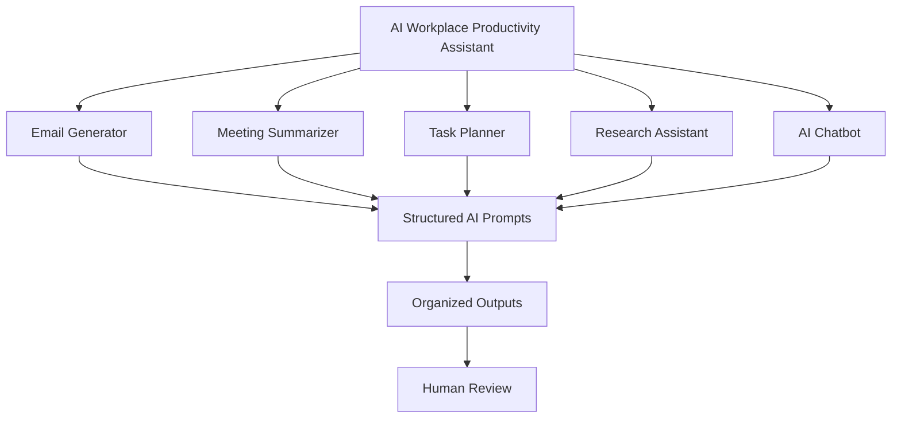

# AI-Workplace-Productivity-Assistant
# ✦ AI Workplace Productivity Assistant

### Intelligent workflows. Human-centered productivity.

An AI-powered productivity platform designed to simplify workplace operations, automate repetitive tasks, and enhance everyday decision-making through artificial intelligence.

  <a href="https://ai-workplace-product-825r.bolt.host">
    <strong>🚀 Explore Live Application</strong>
  </a>

---

## Project Overview

The **AI Workplace Productivity Assistant** explores how artificial intelligence can be integrated into everyday professional workflows to reduce administrative workloads and improve efficiency.

The platform brings essential productivity tools into a centralized workspace, allowing users to generate emails, summarize meetings, organize tasks, conduct research, and interact with an AI assistant.

Rather than treating AI as a replacement for human intelligence, this project explores its potential as a tool for augmenting human capabilities.

## Preview

  <em>Application dashboard preview</em>

<!-- Add your dashboard screenshot here -->

<!--  -->

🔗 [View Live Project](https://ai-workplace-product-825r.bolt.host)

## Core Features

| Feature                  | Description                                                       |
| ------------------------ | ----------------------------------------------------------------- |
| Smart Email Generator    | Creates professional emails based on tone, audience, and context. |
| Meeting Notes Summarizer | Extracts key points, action items, and deadlines.                 |
| AI Task Planner          | Supports task organization, prioritization, and scheduling.       |
| AI Research Assistant    | Simplifies information through summaries and insights.            |
| AI Chatbot               | Provides an interactive conversational workspace.                 |

## Design & User Experience

The interface follows a modern SaaS design philosophy, combining a minimalist layout with subtle futuristic elements.

**Design principles:**

* Warm neutral and nude color palette.
* Responsive dashboard architecture.
* Intuitive sidebar navigation.
* Modular, card-based interface.
* Clear visual hierarchy.
* Human-centered AI interaction.

## Development Approach

This project was developed using AI-assisted development techniques, with an emphasis on translating functional requirements into an interactive web application.

Key development considerations include:

* Structured prompt engineering.
* User interface planning.
* Workflow automation concepts.
* Interactive component design.
* Responsive application development.
* Responsible AI usage.

## Technology Stack

> Update this section with the exact technologies used in the project.

| Layer                | Technology                    |
| -------------------- | ----------------------------- |
| Frontend             | [Add framework]               |
| Styling              | [Add styling technology]      |
| Programming Language | [Add language]                |
| AI Integration       | [Add AI provider/API]         |
| Development Tools    | AI-assisted development tools |
| Deployment           | Bolt hosting                  |

## Application Architecture

The application is organized around five productivity modules connected through a unified dashboard.

*Conceptual workflow illustrating the application's functional structure.*

## Responsible AI

AI-generated content may require human review.

The platform is designed around the principle that AI should support human judgment rather than eliminate the need for critical thinking, verification, and accountability.

## Roadmap

* [x] Design productivity dashboard.
* [x] Establish core feature modules.
* [x] Develop application interface.
* [x] Deploy initial prototype.
* [ ] Integrate and validate live AI services.
* [ ] Implement persistent user data.
* [ ] Introduce authentication.
* [ ] Add productivity analytics.
* [ ] Expand workflow automation capabilities.

## What I Learned

This project represents an opportunity to explore the relationship between software development, artificial intelligence, and practical problem-solving.

Key learning areas:

* Translating requirements into application features.
* Applying structured prompt engineering.
* Designing user-centered interfaces.
* Exploring AI-assisted software development.
* Understanding responsible AI implementation.
* Iterative development and product thinking.

## Future Vision

The long-term objective is to explore intelligent systems that make technology more accessible, productive, and useful in everyday life.

Future iterations may incorporate personalized AI workflows, integrations with professional tools, and more advanced automation capabilities.

---

## About the Developer

**Koketso Oratile Maphoto**

Aspiring Computer Scientist | AI & Technology Enthusiast

Currently developing practical skills in artificial intelligence and software development through the Capacity AI Acceleration Programme.

Interested in building intelligent systems, exploring computational thinking, and applying technology to real-world challenges.

### Connect

* GitHub: [Your GitHub Profile](https://github.com/YOUR-USERNAME)
* Portfolio: [Your Portfolio Website](YOUR-PORTFOLIO-LINK)

---

  <strong>Building with curiosity. Learning through experimentation. Creating with purpose.</strong>

AI-generated content may require human review.
